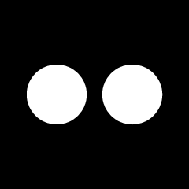

# Otto Robot GIF Emoji Component

ESP-IDF component with **21 animated Otto robot expressions** for LVGL. Every
GIF is drawn procedurally by a Python script in a compact 240 x 240
black-and-white style suitable for an AI robot face.

## Emojis

<table>
  <tr>
    <td align="center"><br><code>neutral</code><br><sub>0 · 😶</sub></td>
    <td align="center"><br><code>happy</code><br><sub>1 · 🙂</sub></td>
    <td align="center"><br><code>laughing</code><br><sub>2 · 😆</sub></td>
    <td align="center"><br><code>funny</code><br><sub>3 · 😂</sub></td>
    <td align="center"><br><code>sad</code><br><sub>4 · 😔</sub></td>
    <td align="center"><br><code>angry</code><br><sub>5 · 😠</sub></td>
    <td align="center"><br><code>crying</code><br><sub>6 · 😭</sub></td>
  </tr>
  <tr>
    <td align="center"><br><code>loving</code><br><sub>7 · 😍</sub></td>
    <td align="center"><br><code>embarrassed</code><br><sub>8 · 😳</sub></td>
    <td align="center"><br><code>surprised</code><br><sub>9 · 😯</sub></td>
    <td align="center"><br><code>shocked</code><br><sub>10 · 😱</sub></td>
    <td align="center"><br><code>thinking</code><br><sub>11 · 🤔</sub></td>
    <td align="center"><br><code>winking</code><br><sub>12 · 😉</sub></td>
    <td align="center"><br><code>cool</code><br><sub>13 · 😎</sub></td>
  </tr>
  <tr>
    <td align="center"><br><code>relaxed</code><br><sub>14 · 😌</sub></td>
    <td align="center"><br><code>delicious</code><br><sub>15 · 🤤</sub></td>
    <td align="center"><br><code>kissy</code><br><sub>16 · 😘</sub></td>
    <td align="center"><br><code>confident</code><br><sub>17 · 😏</sub></td>
    <td align="center"><br><code>sleepy</code><br><sub>18 · 😴</sub></td>
    <td align="center"><br><code>silly</code><br><sub>19 · 😜</sub></td>
    <td align="center"><br><code>confused</code><br><sub>20 · 🙄</sub></td>
  </tr>
</table>

- 240 x 240, white geometry on black, 16-level grayscale antialiasing
- 80 ms per frame, 3.2-4.0 s loops that start on the neutral face and ease back
  to it, so looping and switching expressions are both seamless
- Delta-encoded frames with a single global palette, about 940 KB for all 21
  files

## Requirements

- ESP-IDF
- LVGL >= 9.0

## Usage

Add the component to your project's `idf_component.yml`:

```yaml
dependencies:
  txp666/otto-emoji-gif-component: "^1.4.0"
```

Use the minimal C API to enumerate the available assets:

```c
#include "otto_emoji_gif.h"

printf("Version: %s, Count: %d\n",
       otto_emoji_gif_get_version(),
       otto_emoji_gif_get_count());

const char *name = otto_emoji_gif_get_name(11);  // "thinking"
```

Copy the `gifs/` folder to SPIFFS or an image partition, or embed the files in
your project. LVGL can then open them with `lv_gif_set_src()`.

## Regenerating the GIFs

All 21 expressions come from `tools/generate_emojis.py`; there are no
hand-drawn source assets. With Pillow installed, run:

```sh
pip install pillow
python tools/generate_emojis.py
```

Pass expression names to regenerate only some of them, for example
`python tools/generate_emojis.py happy sad`. The output is deterministic.

Each eye is described by a few parameters (size, tilt, upper and lower lids,
pupil, heart morph, closed-eye curve), so an expression is a target pose plus
idle motion such as bouncing, blinking, tears, hearts or floating `Z`s. To add
or tweak an expression, edit its function and its entry in `EXPRESSIONS`, and
keep the order in sync with `src/otto_emoji_gif.c`.

## Xiaozhi ESP32 integration

Every filename matches the corresponding Xiaozhi `EmojiCollection` name.
No legacy filename aliases are required.

## License

MIT
